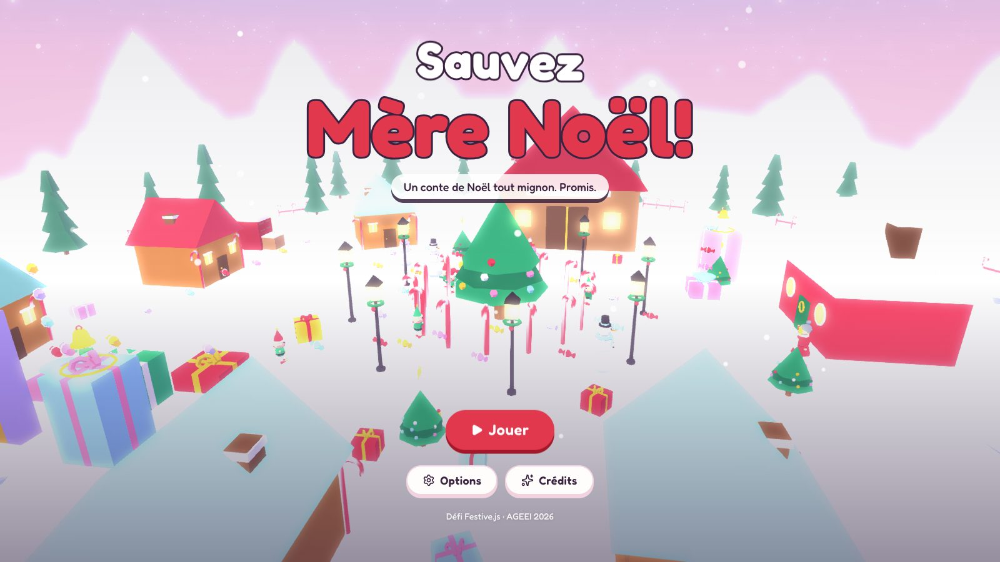
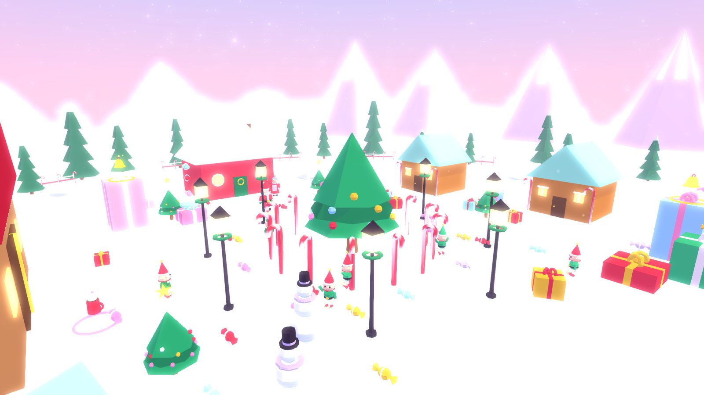
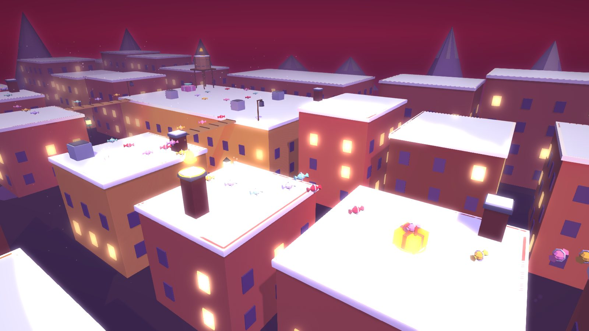
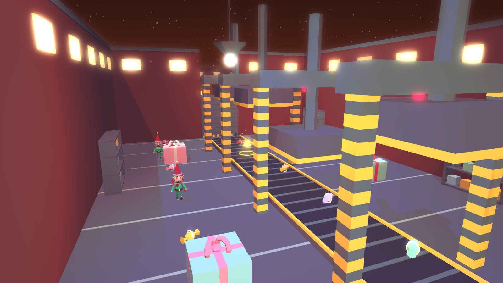
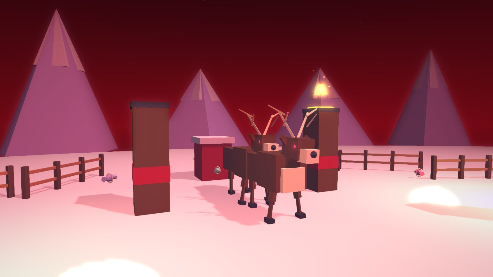
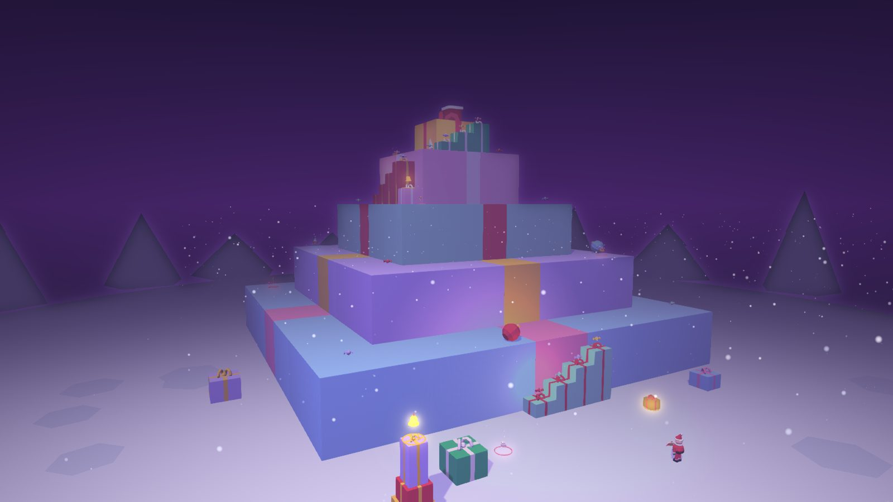
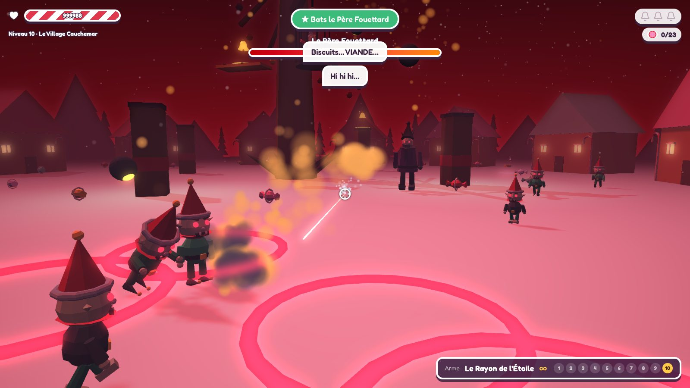
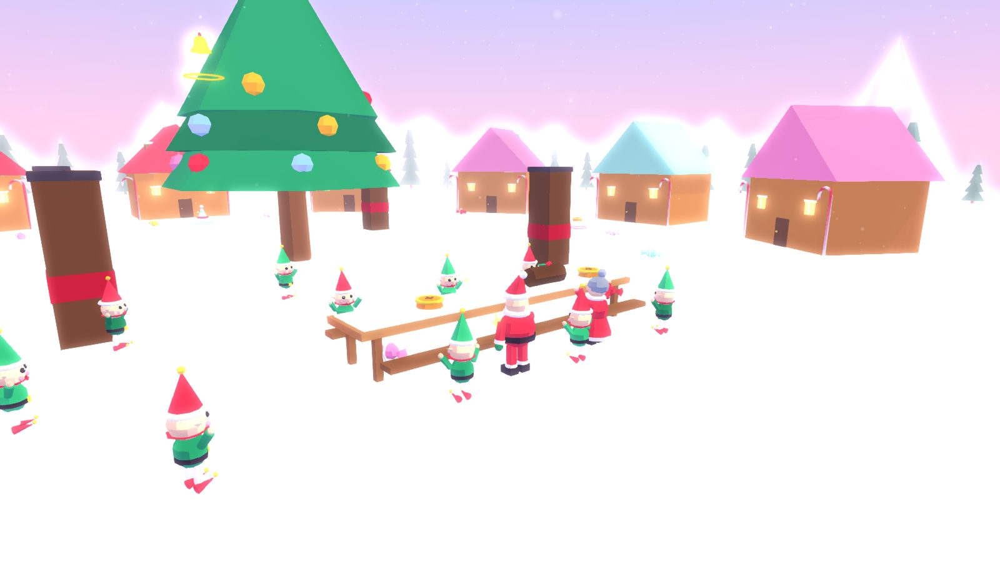

# Sauvez Mère Noël!

*Un conte de Noël tout mignon. Promis.*

A 3D Christmas action-platformer in Quebec French, made with Babylon.js for the AGEEI **Festive.js** contest (UQAM, December 2026).

Père Fouettard has kidnapped Mère Noël and possessed the North Pole: the elves, the reindeer, even the toys. Santa fights his way through eleven levels to get her back, from a candy-coloured village to the nightmare it becomes. The world gets darker and gorier with every level, while the interface stays cute the whole way through.

Every model, animation, sound effect and piece of music is generated in code. The project contains no asset files.

**Play it:** https://noel.lheureux.xyz/



## Screenshots

| | |
| --- | --- |
|  |  |
| Level 0: Santa's village, before it all goes wrong | Level 6: across the rooftops, over a street of cursed slush |
|  |  |
| Level 7: the toy factory's stamping presses | Level 8: Comète Démoniaque waits in the corral |
|  |  |
| Level 9: a mountain made of stolen gifts | Level 10: Père Fouettard, in four phases |



## The game

**Eleven levels**, each with its own mechanic, mood and music:

| | Level | What happens |
| --- | --- | --- |
| 0 | Le Village du Père Noël | Find the star for the great tree. Then the night goes wrong. |
| 1 | La Place du Marché de Noël | Three waves of possessed elves round the carousel. |
| 2 | La Forêt de Sapins Hantés | A foggy forest lit one lantern at a time. |
| 3 | Les Glissades de la Mort | A tube run down the slopes and a chairlift back up. |
| 4 | La Cabane à Sucre | A sugar shack: burning syrup, boiling cauldrons, ornament bombs. |
| 5 | La Patinoire Gelée | Boss: La Surfaceuse Infernale, on a frozen lake that breaks apart. |
| 6 | Les Toits du Village | Rooftop platforming over a street flooded with cursed slush. |
| 7 | La Fabrique de Jouets | Conveyor belts, a grinder, stamping presses and the Toy Machine. |
| 8 | Les Écuries des Rennes | Possessed reindeer that charge. Dodge them, daze them, free the captives. |
| 9 | La Montagne de Cadeaux | Climb a mountain of gifts, tier by tier, through a blizzard. |
| 10 | Le Village Cauchemar | The final boss, Père Fouettard, then the ending. |

**A new weapon in every level:** the candy cane, a cap gun, a shotgun, a candy SMG, a syrup flamethrower, an ornament launcher, an icicle rifle that pierces, a chain-lightning garland, a crossbow with sticky candy-cane bolts, a spin-up gatling, and finally the star from the great tree.

**Also:** telegraphed enemy attacks you can read and dodge, checkpoints, bells and candies to collect, three stars per level, power-ups (rage, speed, shield), a world map, an optional confetti mode in place of the gore, and progress saved in the browser.

## Controls

| Key | Action |
| --- | --- |
| W A S D | Move |
| Shift | Run |
| Space | Jump (press again in the air for a double jump) |
| Q | Dodge |
| Mouse | Look |
| Left click | Attack with what you're holding (hold to keep firing) |
| Right click | Punch, or a belly slam in the air |
| F | Candy cane |
| 1 to 0, mouse wheel | Switch weapons |
| Enter | Next line of dialogue |
| Esc | Pause |

Add `?low` to the URL for half resolution with no shadows or post effects, for older laptops.

## Running it locally

Requires Node 20 or later and pnpm.

```bash
pnpm install
pnpm dev        # http://localhost:5173
```

| Script | What it does |
| --- | --- |
| `pnpm dev` | Dev server with hot reload |
| `pnpm build` | Type-check, then production build into `dist/` |
| `pnpm preview` | Serve the production build locally |
| `pnpm lint` | Biome lint and format check |
| `pnpm format` | Biome auto-fix and format |
| `pnpm typecheck` | TypeScript only |
| `pnpm cf:deploy` | Build and upload `dist/` to Cloudflare Pages with Wrangler |

## How it's built

- **Babylon.js 9** for rendering, particles, shadows, glow and post effects
- **TypeScript**, built with **Vite**
- **React 19, Tailwind CSS v4 and shadcn/ui** (Radix) for the menus and the HUD
- **Zustand** to connect the game and the interface
- **Motion** for interface animation
- **Web Audio** synthesis for every sound and the music box
- **Biome** for lint and formatting, **pnpm** for packages

```
src/
  core/      Game: engine, frame loop, level loading, the script API levels are written in
  assets/    Low-poly model builder, characters, props, palette, materials
  anim/      Joint rigs, procedural locomotion and keyframe clips
  player/    Movement, weapons, the over-the-shoulder camera and cutscene shots
  enemies/   Enemy behaviour (elves, reindeer, nutcrackers, bosses), projectiles
  fx/        Gore and confetti, particles, tracers
  world/     Platformer physics, moods and lighting, the Level base class
  levels/    Level0 to Level10
  audio/     Synthesized sound effects and music
  i18n/      Every line of in-game text, in Quebec French
  ui/        React screens, HUD and menus
tests/e2e/   End-to-end tests (Python and Playwright)
```

Each level is a class that builds its layout in `build()` and plays its story in `run()`, an async script (`await game.say(...)`, `game.wait(...)`, `game.objective(...)`) that stops cleanly if the level is left.

## Testing

The end-to-end tests in `tests/e2e/` drive the real game in Chromium with Playwright. They play the levels with real inputs (every jump on a route, every staircase), check layouts for walls without collision and floating pickups, verify that cutscene cameras have a clear view, and measure frame times on the GPU.

```bash
pip install playwright pillow && python -m playwright install chromium
pnpm dev &
cd tests/e2e && python issues.py   # or level6.py ... level10.py, cutcheck.py, gpuprof.py
```

## Deploying

The game is a static site. Build it with `pnpm build` and serve `dist/`, or deploy to Cloudflare Pages with `pnpm cf:deploy` (after `npx wrangler login`).
